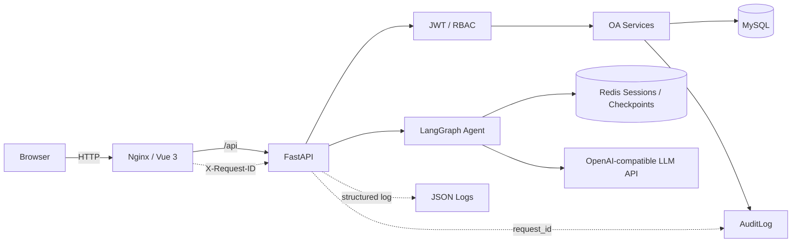

# Smart OA Agent

Smart OA Agent 是一个基于 FastAPI、Vue 3、MySQL、Redis、LangGraph/LLM、JWT 与 RBAC 构建的智能 OA 审批系统。

它不是单纯的聊天 Demo：项目同时包含账号体系、多角色权限、请假审批、站内通知、审计日志、Agent 会话以及 Docker Compose 部署，重点展示传统 OA 业务与 LLM Agent、可观测性和工程化部署之间的集成。

> 当前版本适合学习、工程实践、功能演示和封闭测试。未经额外安全、隐私、合规与容量评估，不建议直接用于真实企业生产环境。

## 核心功能

- JWT 登录认证和 `employee` / `manager` / `hr` / `admin` 四角色 RBAC
- 管理员创建、启停用户及重置密码
- 首次登录强制修改临时密码，改密后旧 Token 失效
- 员工提交、查看和撤销请假
- 主管审批直属员工申请，HR 完成终审
- 站内 Notifications 与角色待办
- AuditLog 与贯穿响应、结构化日志、审计记录的 Request ID
- LangGraph Agent / Chat 和 OpenAI-compatible LLM API
- Redis 会话元数据与 LangGraph Checkpoint 持久化
- MySQL 业务数据持久化
- Health / Readiness 和依赖降级状态
- Docker Compose 一键编排

## 技术栈

### Backend

- Python 3.11
- FastAPI、Uvicorn、Pydantic Settings
- SQLAlchemy、PyMySQL、MySQL
- Redis
- JWT、bcrypt
- LangGraph、LangChain、OpenAI-compatible LLM API

### Frontend

- Vue 3、Vite、Vue Router
- Pinia
- Element Plus
- Axios、dayjs

### Deployment

- Docker、Docker Compose
- Nginx

## 系统架构



MySQL 是用户、请假、通知和审计的业务事实源；Redis 只承载聊天会话与 Agent Checkpoint。LLM 不直接修改数据库，所有业务写入仍经过后端 Service 和 RBAC 校验。

## 角色权限

| Role | 主要能力 |
| --- | --- |
| Employee | 提交、撤销和查看自己的请假，使用 Agent |
| Manager | 审批直属员工申请、查看团队请假，使用 Agent |
| HR | 执行 HR 终审、查看全部请假，使用 Agent |
| Admin | 用户管理、审计日志查询，使用 Agent |

前端菜单和路由守卫用于改善交互；后端依赖与 Service 才是最终授权边界。

## Quick Start：Docker Compose

### 1. 获取代码并创建配置

```bash
git clone <repository-url>
cd Smart-OA-Agent
cp .env.example .env
```

Windows PowerShell：

```powershell
Copy-Item .env.example .env
```

编辑 `.env`，至少替换 MySQL、Redis、JWT 和 LLM 的占位值。不要提交 `.env`。

### 2. 构建并启动

```bash
docker compose build
docker compose up -d --wait
docker compose ps
```

默认访问地址：

```text
http://localhost:8080
```

端口可以通过 `.env` 中的 `APP_HTTP_PORT` 修改。

### 3. 初始化首个管理员

全新数据库没有默认账号。请由部署者显式运行：

```bash
docker compose exec backend python -m app.db.create_admin
```

按提示输入用户名、员工编号、姓名和邮箱。Bootstrap 命令具有以下限制：

- 只允许在 `users=0` 的 Fresh Install 中执行
- 管理员角色固定为 `admin`
- 临时密码只在命令成功后显示一次
- 第一次登录必须修改临时密码
- 数据库已有任何用户时会拒绝执行
- 不会随容器启动自动创建账号

项目没有固定默认密码，也不会在 README、Compose 或初始化 SQL 中保存管理员密码。

### 4. 常用运维命令

```bash
docker compose ps
docker compose logs backend
docker compose logs frontend
docker compose down
```

## 环境变量

完整示例见根目录 [`.env.example`](.env.example)。核心配置分为：

- `APP_HTTP_PORT`、`CORS_ORIGINS`
- `MYSQL_*`
- `REDIS_*`、`SESSION_TTL_SECONDS`
- `JWT_SECRET_KEY`、`JWT_*`
- `LLM_API_KEY`、`LLM_BASE_URL`、`LLM_MODEL`

所有示例值都只是占位符。请使用随机强密码和足够长的 JWT Secret，并确保 `.env` 不进入 Git、镜像或日志。

## Health 与 Readiness

通过对外 Nginx 入口访问：

```text
GET /api/health
GET /api/ready
```

- `/api/health` 汇总应用、MySQL 与 Redis 状态；Redis 不可用时会显示降级，但传统 OA 数据链路仍可继续工作。
- `/api/ready` 主要检查 MySQL 核心依赖；数据库不可用时返回非就绪状态。

## 数据库初始化与迁移

### Fresh Install

首次使用空 MySQL volume 时，[`init_mysql.sql`](backend/app/db/init_mysql.sql) 会自动建立当前最终 Schema。随后使用 Bootstrap 命令创建首个管理员。

### Existing Database

已有数据库不要删除 volume 重新初始化。请先备份，再按照版本顺序审阅并执行 [`backend/app/db/migrations/`](backend/app/db/migrations/) 中的迁移脚本。

迁移脚本不会由 Compose 对已有数据库自动执行；执行前应确认目标版本和备份可恢复性。

## 数据持久化

Compose 使用两个 named volume：

- MySQL 数据卷
- Redis AOF 数据卷

正常停止：

```bash
docker compose down
```

不会删除 named volume。

> **警告：不要在存在重要数据时执行 `docker compose down -v`。** `-v` 会删除 MySQL 和 Redis volume，其中包括业务数据、审计记录和聊天历史。

## 基础备份建议

正式试用前至少应做到：

- 定期生成并验证 MySQL 备份
- 备份 Redis AOF 或对应 named volume
- 将 `.env` 存放在受控位置，并限制读取权限
- 定期执行恢复演练，而不只是确认备份文件存在

MySQL dump 示例（请把输出写到仓库外的安全目录）：

```bash
docker compose exec -T mysql sh -c 'MYSQL_PWD="$MYSQL_ROOT_PASSWORD" mysqldump -u root --single-transaction --routines --triggers --events smart_oa' > /secure/backup/path/smart_oa_backup.sql
```

命令中的密码来自容器环境，不要把真实密码直接写入脚本或命令历史。

## 日志与 Request ID

Backend 输出 JSON 结构化请求日志：

```bash
docker compose logs backend
```

响应头中的 `X-Request-ID` 可用于关联：

```text
HTTP Response → Backend JSON Log → AuditLog
```

报告问题时可以提供 Request ID；发送日志前仍应删除 Token、凭据、个人信息和业务敏感数据。

## Local Development

Docker Quick Start 与本地开发是两种独立方式。详细后端与前端说明分别见：

- [`backend/README.md`](backend/README.md)
- [`frontend/README.md`](frontend/README.md)

### Backend

```bash
cd backend
python -m venv .venv
# 激活虚拟环境
python -m pip install -r requirements-dev.txt
cp .env.example .env
uvicorn app.main:app --reload --host 127.0.0.1 --port 8000
```

PowerShell 可用 `Copy-Item .env.example .env` 代替 `cp`。

### Frontend

需要 Node.js 和 pnpm 11.19.0：

```bash
cd frontend
pnpm install --frozen-lockfile
cp .env.example .env
pnpm run dev -- --host 127.0.0.1 --port 5173
```

## Automated Tests

Backend：

```bash
cd backend
python -m unittest discover -s tests -v
```

当前测试集包含 77 项测试，覆盖 Auth、RBAC、Password、Token、Users、Audit、Request ID、依赖降级、Health 和 Bootstrap Admin。

Frontend：

```bash
cd frontend
pnpm install --frozen-lockfile
pnpm run build
```

Compose 配置：

```bash
docker compose config --quiet
```

## 项目结构

```text
Smart-OA-Agent/
├── backend/                  # FastAPI、Agent、Service、Models、Tests
├── frontend/                 # Vue 3、Pinia、Element Plus、Nginx
├── docs/                     # 架构、演示与脱敏截图说明
├── .github/ISSUE_TEMPLATE/   # Bug / Feature 模板
├── compose.yml
├── .env.example
├── SECURITY.md
├── CONTRIBUTING.md
└── README.md
```

## 项目截图

公开截图尚未纳入仓库。截图规范见 [`docs/screenshots/README.md`](docs/screenshots/README.md)：截图前必须使用虚构数据，并移除密码、Token、API Key、邮箱和其他敏感信息。

## Known Limitations

- 公开模板默认使用 HTTP；公网测试必须配置 HTTPS
- Secret 当前通过本地 `.env` 注入，不是专用 Secret Manager
- LLM 调用依赖外部供应商的可用性、配额和数据策略
- General Chat Prompt 仍有优化空间
- 前端主 bundle 较大，尚未完成进一步拆包
- 尚无集中式日志系统
- 尚未完成高并发生产压测
- JWT 当前存储在浏览器 localStorage，适合演示和封闭测试，不是生产环境的最终方案

## Roadmap

- [x] Core OA workflow
- [x] RBAC
- [x] Agent integration
- [x] Audit / Request ID
- [x] Docker Compose
- [x] Fresh-install bootstrap
- [ ] HTTPS deployment
- [ ] 5-user Alpha test
- [ ] 20-user Beta test
- [ ] CI/CD
- [ ] Frontend chunk optimization
- [ ] General Chat prompt improvement

## Security 与贡献

- 安全边界与报告方式：[SECURITY.md](SECURITY.md)
- 本地开发和提交规范：[CONTRIBUTING.md](CONTRIBUTING.md)

## License

License 尚未决定。在正式公开发布前，应由项目所有者选择并添加合适的许可证。
